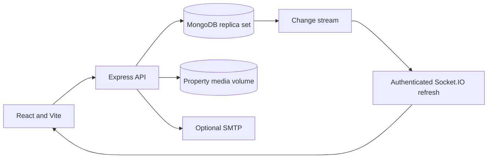

# LuxuryStay Intelligence

A MERN hotel platform with a public property catalog, guest reservations, branch-scoped front desk and hotel operations, and a multi-property command center.

## Run locally

Use Node.js 24+, npm, and Docker with Compose. From the repository root:

```sh
npm ci
docker compose up -d --wait
cp .env.example .env
```

On PowerShell, use `npm.cmd` and `Copy-Item .env.example .env` if needed. Add your own `DEMO_PASSWORD` to `.env`, then run `npm run seed` and `npm run dev`. In a second terminal, run `npm run web`. Open the URL Vite prints, normally `http://localhost:5173`.

Use `guest@demo.luxurystay.test` at `/login`. At `/staff/login`, use one of these names followed by `@demo.luxurystay.test`:

| Account | Workspace |
| --- | --- |
| `super-admin` | All branches, staff accounts, and command center |
| `branch-manager` | Dubai operations, staff assignments, policy and rate approval |
| `receptionist` | Dubai front desk and reservation lookup |
| `housekeeping` | Dubai cleaning and housekeeping requests |
| `maintenance` | Dubai maintenance and maintenance requests |
| `finance` | Dubai billing and reporting |

The seed adds fictional Dubai and London properties and demo accounts. The same local password is used for all accounts on first seed. Re-running the seed preserves existing passwords and inventory.

## Walk through a stay

1. In the public catalog, open a Dubai room, select hotel-local dates and check availability. Continue through guest sign-in. Place a 15-minute hold, then confirm with simulated payment.
2. From the confirmation, save the QR image or copy its reference. In a separate browser profile, sign in as a receptionist or manager. Open the front desk and find the reservation by reference or upload the QR image. Staff can also create a walk-in.
3. Verify the guest and check in. Record a key or incidental charge. Check out to issue a PDF and create a cleaning task. The invoice records room charges, adjustments, configured tax, simulated payments and the remaining balance.
4. In the manager's Digital Twin, select the floor and dirty room. Review the readiness estimate and approve the suggested cleaner, or choose another in Housekeeping. Start, complete and inspect the task. The inspected room returns to the ready inventory.
5. Open property performance and pricing. Compare trends across authorized properties, export data, and review a recommendation before approving a new rate. Guest service requests and reviews are managed in the corresponding staff tabs.

The Digital Twin is a room schematic built from live inventory, grouped by floor. The readiness, assignment, feedback and pricing tools use explainable rules. The concierge answers from configured hotel facts and the signed-in guest's own reservations. Payments are simulated.

## Test

```sh
npm test
npm run build
npm audit --omit=dev
```

The integration tests use temporary databases on the local replica set, or `TEST_MONGODB_URI` if configured. They exercise booking concurrency and expiry, branch and guest isolation, walk-in and front-desk operations, invoices, housekeeping, maintenance, pricing, guest services, moderation, real Socket.IO delivery, and account links using a local SMTP test server. Keep the local MongoDB volume when restarting the app.

## Production

Build a Docker image with `docker build -t luxurystay .`. If the build runs behind a trusted corporate proxy, pass the CA as a BuildKit secret with `--secret id=proxy_ca,src=/path/to/ca.pem`. The CA is mounted during installation and is excluded from image layers.

Deploy behind an HTTPS reverse proxy with WebSocket upgrades for `/socket.io/`. The container listens on port 3001 by default and serves the built frontend and API from the same origin. Set:

- `APP_ORIGIN` to the canonical public HTTPS origin without a path or trailing slash.
- `MONGODB_URI` to an authenticated replica set or supported cluster. The bundled Compose replica set is for development.
- `SMTP_URL` and `MAIL_FROM` together to turn on account and operational email. Use the platform’s secret store for credentials.
- `PORT` if the hosting service assigns a different port.

Provision the first super admin once using `npm run bootstrap:admin` with `MONGODB_URI`, `BOOTSTRAP_ADMIN_EMAIL`, `BOOTSTRAP_ADMIN_NAME`, and `BOOTSTRAP_ADMIN_PASSWORD` set securely. In the image, the equivalent command is `node apps/api/src/bootstrap-admin.js`. Remove the bootstrap credentials from the runtime after use. Demo seeding is disabled in production.

A public deployment needs a hosting target, MongoDB credentials and HTTPS. Real email delivery needs a sender. Newsletter signup collects opt-in records. Campaign delivery and live payment processing require separate provider integrations.

## Staff operations and settlement

Managers can create a staff hold and return to it from the reception queue. The
default expiry is 15 minutes. Set `BOOKING_HOLD_MINUTES` to an integer from 1
to 30. A guest can hold at most five concurrent reservations.

A guest or authorized staff member can record a **simulated** payment after
checkout from the invoice detail. Finance and management can also record a
simulated refund. These transactions are append-only and the original PDF
retains its amounts at issue time. The workspace shows the current outstanding
balance and settlement history. Reports show settlement payments and refunds
separately from booking simulation totals.

Managers can set an active housekeeping shift and save a room's row and column
in the Digital Twin. A cleaner without an active property shift is excluded
from recommendations and new assignments. The first layout is a room grid.
Guests can open a private complaint on an eligible stay, track the department
and status, and see the manager's resolution.

## Property photographs and source record

The six bundled WebP files in `apps/web/public/images` (atrium, London,
king, king-detail, suite, and suite-detail) were generated for the LuxuryStay
demo. They illustrate fictional locations or categories. No third-party hotel
site photographs were used for these files.

Managers can publish their own JPEG, PNG, or WebP photos up to 3 MB, assign
them to the property or a room category, and supply alt text, source and usage
rights. Sort order controls the gallery order. MongoDB holds the metadata.
Binary files are stored in `MEDIA_DIRECTORY` (defaults to `.local-media`).
For a container deployment, mount a persistent volume writable by the
container's `node` user. Back up that volume alongside MongoDB. The uploader
remains responsible for verifying publication rights.

## Architecture and API entry points



| Route | Purpose |
| --- | --- |
| `GET /api/health` | Check database connectivity |
| `GET /api/availability` | Check branch, dates and party size |
| `POST /api/reservations/holds` | Create guest hold with a UUID idempotency key |
| `POST /api/reservations/:reference/confirm` | Confirm with simulated payment |
| `GET/POST /api/reservations/:reference/settlement` | View or pay a guest-owned issued invoice balance |
| `GET/POST /api/staff/properties/:branchId/reservations/:reference/settlement` | Scoped staff settlement |
| `GET/POST /api/staff/properties/:branchId/media` | Scoped manager media library |
| `GET/POST /api/guest/complaints` | Submit and track private guest complaints |
| `GET /api/staff/command` | Scoped property performance metrics |

Leave `TRUST_PROXY_CIDRS` unset for direct access. Behind an HTTPS reverse
proxy, supply only the exact proxy IPs or CIDRs you control. After configuration,
verify both rate limiting and the WebSocket upgrade through the actual proxy.

## Browser regression

Start the local Compose database, then run `npx playwright install chromium`
and `npm run test:browser`. The browser tests start a separate API and web server
on ports 3301 and 5181, seed a randomly named database on the local replica set,
and remove that test database afterward. On an environment with a compatible
system Chromium, set `BROWSER_EXECUTABLE` to its path. The GitHub Actions workflow
runs the API tests, production build, and browser suite.

## Package reservations and operational exceptions

Managers can publish a package from **Offers** in the branch workspace. Set a booking window, stay window, category, minimum nights, discount and use limit. The public offers page links to date selection. A hold recalculates the discounted rate and claims a package use and all room nights in one transaction. A confirmed booking retains its package terms. Included services describe the package and remain a staff fulfillment responsibility.

Reception can mark an unarrived reservation as a no-show after its local arrival day. Unused future room nights are released and recorded payment history is retained. Staff can request an overdue extension or approve a local same-day late departure. Both operations require conflict-free room nights. Finance can record reasoned credit adjustments against issued invoices. Credits change the current amount due separately from payments and refunds.

An emergency maintenance block protects inventory immediately and preserves affected reservations. Authorized desk staff can see references to review and relocate a checked-in stay to a ready room in the same category. Staff must relocate the occupant before resolving the emergency. The previous room history is retained. Managers can approve overdue and cross-category moves using the recorded exception workflow below.

The Twin stores room positions and cell dimensions, rejects overlapping rectangles, and allows zooming. Guest services now show a timestamped status timeline and staff completion notes.

## Acceptance and recovery checks

Use the project commands in this order:

```sh
npm ci
docker compose up -d --wait
npm run lint
npm test
npm run build
npx playwright install chromium
npm run test:browser
npm audit --omit=dev
```

The browser suite includes axe-core checks on selected public pages and all
seven role landing screens at a 390 px viewport, plus a keyboard skip-link
check. Automated checks cover a subset of accessibility requirements. Review
the workflows with keyboard and screen readers before release.

The GitHub Actions workflow runs installation, lint, integration tests, build
and Chromium tests. The local suite uses MongoDB test databases and a loopback
SMTP server. In production, configure `SMTP_URL`, `MAIL_FROM` and `APP_ORIGIN`
with the chosen email provider and HTTPS domain. Keep the live credentials in
the deployment secret store. The example file contains placeholders.

### Finance and emergency relocation

New invoices freeze the total plus a separate breakdown of charges, discounts,
tax, deposits, payments and refunds. The settlement panel explains that
starting point and any later transactions. A negative balance represents a
credit owed to the guest. Bookings changed or cancelled after this update keep
the existing payment record and append a simulated payment adjustment or
cancellation refund. Older invoices and payment records keep their original
stored values.

An overdue or cross-category emergency relocation requires manager approval
and a reason. An overdue move also requires a new checkout date. The move keeps
the booked rate and confirms the replacement room's capacity before claiming
only the remaining nights. The previous room, reason, actor and change are
recorded in the audit trail. Upcoming allocations can still reject the move.

### Backup and restore runbook

Use an authenticated MongoDB backup account and an encrypted backup destination.
Before the first production release, schedule database snapshots and separate
snapshots of `MEDIA_DIRECTORY`. Coordinate the two snapshots so restored
metadata references the correct binary files. Record the backup time, database
name, and application version. Restrict access to the backups and agree on
retention with the property operator.

For a restore drill, restore the snapshot to a new isolated database and media
directory, then point a private test instance at those copies. Verify that
branch access, image retrieval, issued invoice totals, and representative
reservation history match the snapshot. Record restoration time and missing
data. Keep the running production database and media volume in place while
validating. Restore to production only using an approved change window and a
separate verified fallback snapshot.

### Invoice reconciliation and CSV downloads

Open **Reconciliation** in a Finance, Branch Manager or Super Admin workspace
after selecting a property. The report selects invoices issued within an
inclusive UTC date window and includes their settlements posted through the end
of that window. The issue snapshots and settlements are read in one MongoDB
transaction. All amounts in CSVs are signed or unsigned integer minor units as
indicated by the column. Summary amounts are grouped by currency.

- **Invoices CSV** includes issued breakdown, posted payments, refunds, credits,
  closing balance and any issue variance. The closing balance is the stored
  issued balance minus posted payments plus refunds minus credits.
- **Settlement ledger CSV** includes the transaction ID, posting time, reason,
  actor ID and idempotency key. Guests, receptionists and operational staff
  cannot download these reports. Branch managers and finance staff can access
  only their assigned properties.
- **Posting journal CSV** includes persisted booking payments, booking
  adjustments, desk entries and settlements posted within the UTC window,
  including settlements on older invoices. Signed net receipts exclude desk
  billable charges and credits, which have their own columns. Legacy booking
  payments marked refunded in place have a blank net-receipts amount because
  the original refund event is unavailable. A blank actor means the source
  record lacks an actor.
- **Legacy invoices** preserve their issue totals. Missing breakdowns are
  identified and exported as blank fields. A variance is the stored issued
  balance minus the difference between the issued total and issued net paid.

The exports accept `from` and `through` dates and `kind=invoices`,
`kind=settlements`, or `kind=journal` at
`/api/staff/properties/:branchId/finance/reconciliation/export`. The largest
window is 366 days. Reports cap matching invoices at 5,000 and the posting
journal at 20,000 entries. The
Command Center’s **Net simulated booking receipts** counts booking payments
plus date-change and cancellation adjustments in property-local dates.
Post-checkout settlements appear separately. The invoice cohort’s closing
balance is a different measure from the Command Center’s current outstanding
balances across all invoices. Certified period totals, recognized revenue reporting, and historical
accounting backfill remain open.

### Hosted launch checks

1. Build the image from the intended release snapshot. Set the canonical
   HTTPS origin, an explicit authenticated MongoDB connection string, the
   platform port and a persistent writable media volume. Keep the service
   private behind the reverse proxy. Use only explicit trusted proxy
   IP addresses or CIDRs and configure the proxy to replace forwarded headers
   supplied by clients.
2. Forward the same origin to both the UI and API, including WebSocket upgrades
   under `/socket.io/`. Confirm the production cookie is Secure and HttpOnly
   with SameSite=Lax on the hosted route. Exercise valid same-origin writes,
   rejected cross-origin writes, booking rate limits via the proxy, a password
   reset and a WebSocket reconnect. Monitor application error logs and avoid
   logging credentials, cookies or reset URLs at the proxy.
3. Point readiness and the container health check at `GET /api/health`.
   This endpoint pings MongoDB. Verify the configured port and run the private
   release-browser tests before exposing traffic. Exercise actual replica-set
   failover and a coordinated database and media restore in staging.
4. To verify email, first use the localhost SMTP test in
   `apps/api/test/operations.test.js`. Before public launch, configure the
   approved SMTP sender and verify real delivery to controlled mailboxes,
   domain authentication and queue failure alerting. The local tests do not
   exercise deliverability.

### Independent acceptance checks

The [original specification matrix](SPECIFICATION_ACCEPTANCE.md) links each
indexed source item to its current evidence. Rows with only a section-level
reference still need individual acceptance.

Reconciliation classifies revenue at invoice issue as the reconciled issued
subtotal less tax. Net booking receipts, desk tender, refunds, credits and
receivables remain separate measures. Credits lack a recognized-revenue or
tax allocation and appear as distinct ledger movements. Historical
reconstruction is a read-only backfill. It matches issued room and line
items against pre-issue desk and booking records, then checks the issued
subtotal, paid amount and balance. Ambiguous records stay unclassified and
appear in the **Accounting exceptions CSV**. The original invoice remains
unchanged. Each finance CSV records an audit event with actor, branch, export
type, date range and row count before the response is sent.

Use an isolated local MongoDB replica set for these additional checks:

```sh
LUXURYSTAY_EXTENDED_TEST=1 node --env-file-if-exists=.env --test \
  --test-name-pattern='repeated competing|repeated package' apps/api/test/operations.test.js
bash scripts/test-mongo-restart.sh
```

The extended tests spread the same set of competing writes across a longer
window. The restart drill starts and removes its own single-node Docker
fixture on loopback port 27117. It checks an observed outage, driver
reconnection, preservation of committed data and a new transaction after
restart. It does not simulate multi-node failover.
